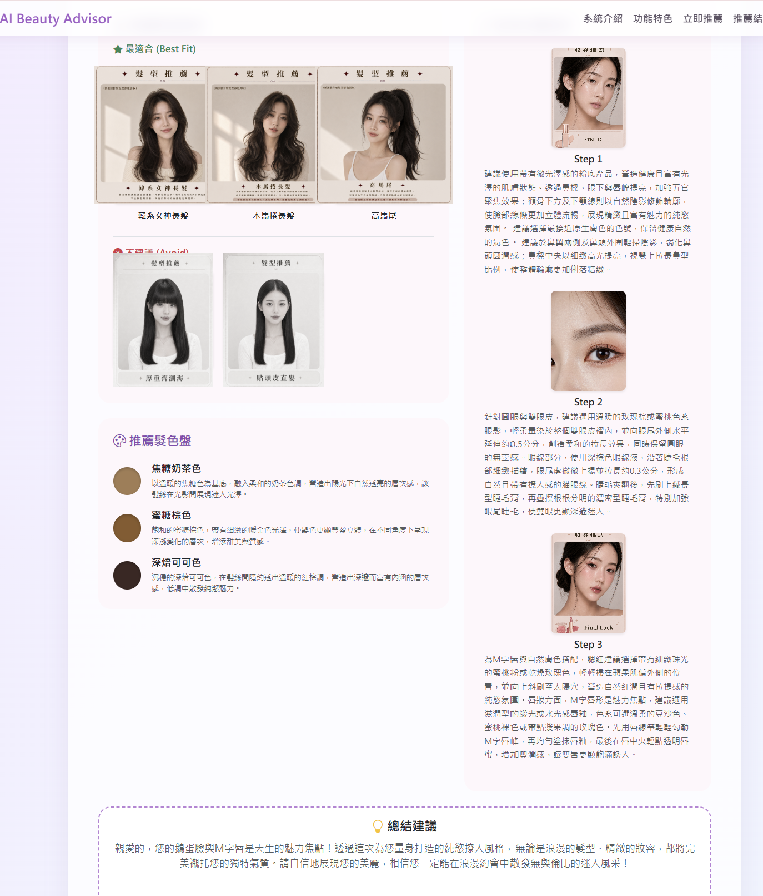
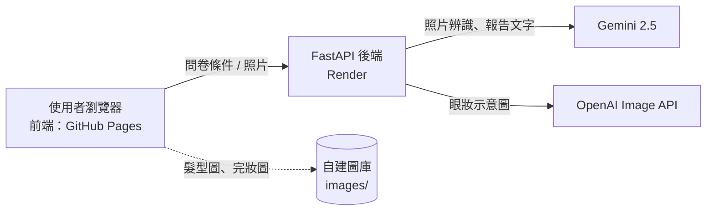

# AI Beauty Advisor｜AI 髮型與妝容推薦網站

上傳一張照片，AI 會辨識臉型與五官，再依你的膚色、髮長、風格與場合，產出個人化的髮型、髮色與妝容報告。

**🔗 Live Demo：<https://411277024.github.io/AI_beauty_project/>**

> ⏱ 後端使用免費主機，閒置後會休眠，**第一次按「產生推薦結果」可能要等 30～60 秒**，之後就很快。



## 功能

- **照片分析**：上傳照片，由 Gemini 辨識臉型、眼型、眼皮、鼻型、唇形，自動帶入問卷
- **個人化報告**：3 款推薦髮型、2 款不建議髮型、3 組髮色，以及底妝／眼妝／唇頰三步驟與總結建議
- **眼妝示意圖**：依使用者的眼型與眼皮，由 AI 即時生成
- **儲存報告**：一鍵把報告存成圖片
- **夜間模式**，支援手機版面

## 系統架構



前端與後端分開部署：

| 部分 | 位置 |
|---|---|
| 前端（本 repo） | GitHub Pages |
| 後端 API | [AI_beauty_api](https://github.com/411277024/AI_beauty_api)（FastAPI，部署在 Render） |

## 設計重點

**1. 混合式架構：圖庫與 AI 各做擅長的事**
髮型圖與完妝圖由自建圖庫提供，個人化的眼妝與髮色建議才交給 AI 即時生成。原因是 AI 生圖費時、費用高，而且臉部五官容易變形；圖庫能保證品質穩定、回應也快。

**2. 多層容錯，服務不中斷**
- Gemini 遇到流量限制（HTTP 429）或錯誤 → 後端自動改用備用報告
- OpenAI 畫圖失敗 → 不給圖，前端改用預設眼妝圖
- 後端完全連不上 → 前端用內建的髮色與妝容資料產出結果

**3. 安全與成本控制**
- API 金鑰只放在後端的環境變數，不在前端、不進 Git
- CORS 只允許本網站的網域
- 每個 IP 每小時限制請求次數，避免額度被刷光
- 上傳照片限制 8 MB，縮圖後才送分析，**只在記憶體處理，不存檔**

## 技術

HTML／CSS／JavaScript、Bootstrap 5、html2canvas ｜ Python、FastAPI ｜ Gemini 2.5、OpenAI Image API ｜ GitHub Pages、Render

## 專案結構

```
AI_beauty_project/
├─ index.html      頁面
├─ script.js       邏輯、髮型與妝容資料庫、呼叫後端
├─ style.css       樣式（含夜間模式）
├─ images/         自建圖庫（髮型、底妝、完妝）
└─ docs/           README 用的截圖
```

## 在本機執行

**只看前端（離線模式）**：下載後直接用瀏覽器開 `index.html`。`script.js` 最上面的 `PROD_API` 留空時，不會呼叫任何 AI，改用內建資料產出結果。

**接上自己的後端**：到 [AI_beauty_api](https://github.com/411277024/AI_beauty_api) 照說明啟動後端，再把 `script.js` 最上面改成：

```js
const PROD_API = "https://你的後端網址";
```

## 隱私說明

照片會傳送到 Google Gemini 進行分析。後端只在記憶體中處理，不會儲存任何照片。

## 已知限制與之後想做的

- 免費主機會休眠，第一次回應較慢
- 後端使用的 `google-generativeai` 套件官方已停止更新，之後會改用 `google-genai`
- 髮型與妝容目前以規則加圖庫為主，之後可以加入使用者回饋，持續改進推薦

## 作者

沈奕昕 Yihsin Shen｜國立高雄師範大學 軟體工程與管理學系｜[GitHub](https://github.com/411277024)
